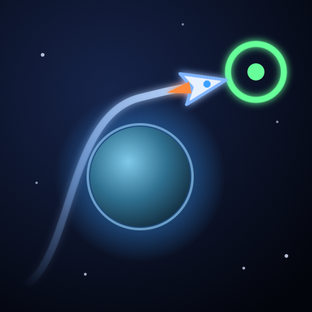
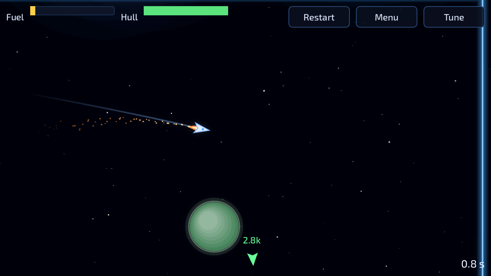
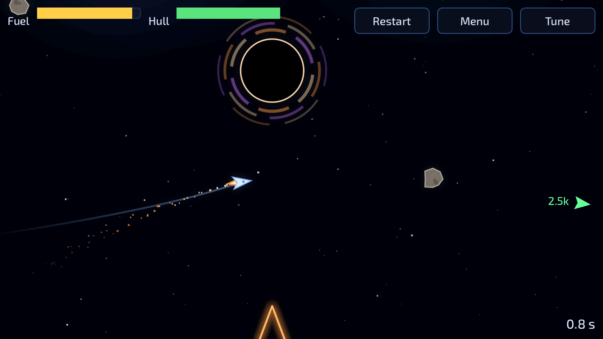
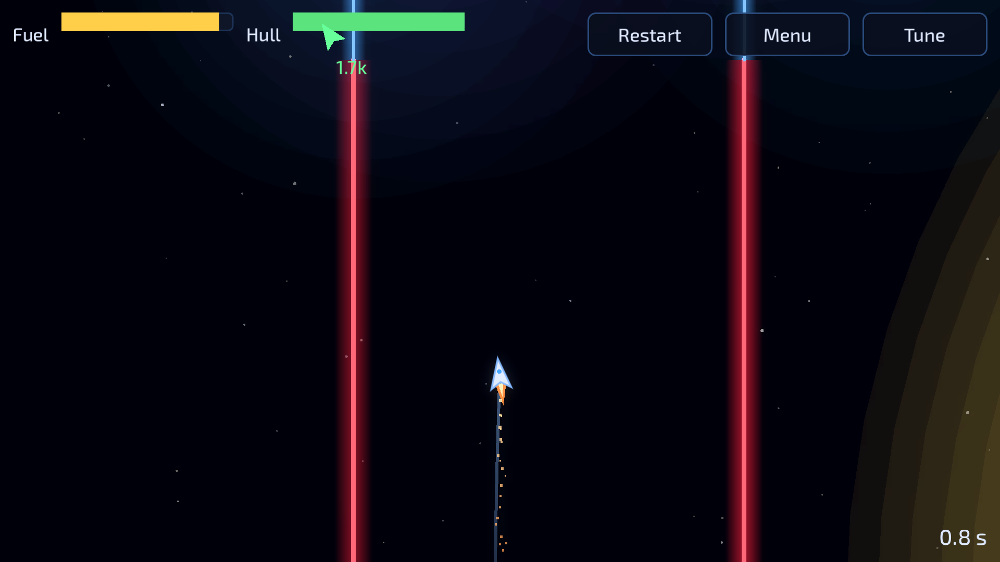
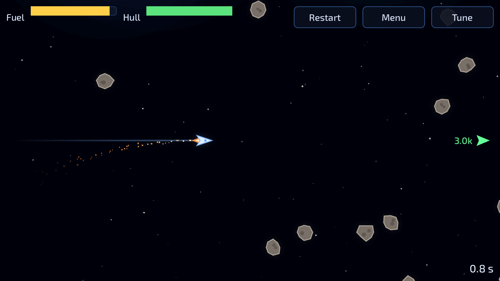

<p align="center">
  
</p>

<h1 align="center">Zero-GX</h1>

<p align="center">
  <strong>No friction. No brakes. Just you, your fuel, and gravity.</strong>
</p>

<p align="center">
  <a href="https://github.com/BRAITG/zero-gx/releases"></a>
  <a href="https://github.com/BRAITG/zero-gx/actions/workflows/build.yml"></a>
  <a href="LICENSE"></a>
  
  
</p>

Zero-GX is a 2D physics game for Android, built with Godot. Fly a ship from start to goal through courses of energy barriers, using planets, black holes and stars as gravity wells, with limited fuel and hull. Nothing slows you down: every push you make, you have to undo. The original design is in [`docs/superpowers/specs/2026-10-12-zero-gx-prototype-design.md`](docs/superpowers/specs/2026-10-12-zero-gx-prototype-design.md).

<p align="center">
  
  
  
  
</p>

## Features

- **Real momentum.** One finger turns and thrusts; let go and you coast forever.
- **Gravity as a tool.** Swing around planets, keep clear of black holes, cross the pull of stars.
- **Twelve levels, plus seven training stages**, scored on fuel left, hull left and time.
- **A level editor in the app.** Build, test and replay your own courses.
- **Free software.** AGPL-3.0-or-later, with only free assets.

## Play on Android

Every push to `master` publishes a debug-signed APK as a prerelease on the [Releases page](https://github.com/BRAITG/zero-gx/releases). Open the latest one on the phone, download `zero-gx.apk`, allow installs from the browser, and open the file. Builds share one signing key, so a newer APK installs over an older one.

Controls: touch and hold anywhere. The ship turns toward your finger and thrusts while you hold; release to coast. Other touch layouts, a keyboard, a mouse and a gamepad also work; see [Controls](#controls).

The home screen separates **Official levels**, **Community levels** (where supported), and **Training**, with My levels, Settings and Credits in a smaller utility row. Official levels and Training open their own scrolling stage lists: each row shows the stage's thumbnail, its number and title, and its best score with the time, fuel and hull points under it; Back returns home. Menu content stays inside a centered 16:9 frame, fitted within the device's reported safe area on mobile. Backgrounds, gameplay, the flight HUD and the editor canvas still use the full screen.

**Thumbnails.** Each official level and training stage has a composed scene that shows what it is about (a swing around a planet, a gap between asteroids, a black hole), not a map of the stage. They are drawn in code, one scene per stage in `scenes/thumbnail.gd`, in the game's own ship, wall, pickup and gravity-body shapes, so they stay crisp at any size and can be tweaked like any other drawing. To look at them all without opening the menu, render them to `build/thumbnails/` (full size and phone size), and each official level's sketch to `build/thumbnails/sketch/`, in a real window: `godot --path . -s res://tools/render_thumbnails.gd`.

## Play or edit on a computer

1. Install [Godot 4.7.2](https://godotengine.org/download/archive/4.7.2-stable/).
2. Open `project.godot`.
3. Press F5. The mouse aims the ship and left click fires.

Levels live in `levels/` as level files (see [Level files](#level-files)). Build your own in the app: **My levels** in the main menu opens the level editor (`scenes/editor.gd`). Pick a tool from the bottom palette (walls, planets, black holes, stars, asteroids, pickups, start and goal); one finger places or drags, two fingers pan and pinch-zoom. Walls, the start and the goal snap to a 10 m grid; turn on **Fine grid** for 1 m steps, which also shows the 1 m grid. Everything else goes exactly where you put it, and pressing anywhere on something already placed (a star's glow included) picks it up instead of adding another. Holding still on a thing for half a second, with any tool, opens its sheet, as does a tap with **Select**. Each body has its own radius, mass and reach, each set on its own within its kind's range. Mass is the pull at 100 m, so a smaller body of the same mass pulls harder near its surface. Every slider has a box for typing an exact value. The ship's sheet sets its starting direction and speed, drawn as an arrow from the start. **Settings** sets the title, hint, fuel, hull and velocity arrow. **Test** flies the level: finishing it marks the level completed until its next change, and returning keeps your undo history. Your levels are saved on the device in `user://levels/` (`scripts/my_levels.gd`); the editor's model with undo is `scripts/level_doc.gd`.

The editor shows the draft title, **Saved** or **Unsaved**, and a hint for the selected tool. **Wall** and **Pickup** have explicit type selectors; selecting a tool does not change its type. **Undo** is disabled when there is no history. Back, Test and Ctrl/Cmd+S save the draft; a failed save keeps the editor open and reports the error. In **My levels**, an invalid draft shows why **Play** is disabled.

**Erase** removes what a tap lands on. Erasing a point of a closed wall asks whether the wall stays closed or opens where the point was; a three-point wall always opens, since two points cannot close.

**Import and export.** **Import** in My levels reads a level file (`.json` or `.json.gz`, including the official levels in `levels/`) as a new draft; a file that is not a Zero-GX level, or is malformed, is refused with the reasons. **Export** writes the level as plain `.json`, in the stable layout. Both use the system's file dialog; on Android that is the system picker, which lists Downloads, USB and local storage. In the editor on a computer, the left mouse button acts like a finger, the right or middle button drags the view, the wheel zooms at the cursor (on a Mac trackpad, pinch to zoom and swipe to pan), Ctrl/Cmd+Z undoes, Ctrl/Cmd+S saves, and T test-flies. These shortcuts are off while a sheet or Settings is open.

## Controls

The last device you use drives the ship. Every binding can be changed in **Settings → Controls**, which saves them with the other settings.

| Action | Keyboard | Mouse | Gamepad (preset A) | Gamepad (preset B) |
|---|---|---|---|---|
| Steer | WASD or arrow keys | cursor | left stick | right stick |
| Fire | Space | left button | A | D-pad up |
| Pause | Esc | | Start | Start |

Keys and sticks point the ship in the direction you press, and it holds that heading when you let go. With the mouse, the nose follows the cursor and a button fires; turn off **Mouse cursor aims** to aim and fire with a click instead.

Menus work with the keyboard and a gamepad: the D-pad, left stick or arrow keys move the focus, Enter or A selects, and Esc or B closes an overlay (the level editor's sheets too) or goes back (the main menu ignores it). In a level, **Pause**, Esc or Start opens the pause card, which offers Resume, Settings, Restart and Menu (Edit during a test). Settings and its Controls sheet keep the flight paused; close them before resuming with Resume, Esc, Start or B. Display and control changes apply to the current flight.

On a touchscreen (the touch options are hidden on devices without one), **Controls** offers three layouts, with a diagram of the one you choose:

- **One finger** (default): touch and hold to turn toward your finger and thrust.
- **Stick + button**: a floating stick appears where your thumb lands on one half of the screen; the other half is the fire button.
- **Finger + button**: a finger anywhere aims the ship, and a round fire button sits in a bottom corner.

In the last two you choose which side holds the on-screen fire button. **Change** replaces a binding of the same kind (key, mouse button or gamepad button) and **Add** gives the action one more; Esc cancels. Stick axes are set by the gamepad preset. **Reset to defaults** restores everything on the screen.

Gamepad bindings use player-facing names such as “Left stick left” and “A / Cross”. Level 1's introduction follows the active input scheme and configured fire bindings; custom level hints remain unchanged.

While a thumb holds the virtual stick, a second finger cannot press **Pause**: Godot turns only the first touch into the clicks buttons need, so lift the thumb first.

## Tests

```sh
tests/run.sh   # needs `godot` on PATH, or GODOT=/path/to/godot
```

The suite runs headless at a fixed 60 FPS. `tests/test_levels.gd` checks the level-design rules: every level is well formed, and with no player input no asteroid ever hits a planet within 60 seconds.

The starfield uses GPU-instanced stars and shader-drawn motion streaks, rather than separate draw calls for each dot and line. Check its rendering budget in a real window (not headless):

```sh
godot --path . -s res://tools/check_starfield.gd
```

The check fails above 1,000 draw calls at rest or with streaks in either direction. On an M1 Pro, batching reduced this check from about 18,100 to 533 draw calls while moving. A separate Level 1 benchmark at 5120×2880 improved from about 16 to 134 FPS with bloom enabled and VSync disabled; disabling bloom alone before batching only reached 17 FPS.

## Build pipeline

`.github/workflows/build.yml` runs the tests, exports the APK and the desktop builds (Windows, macOS, Linux), and uploads them as a workflow artifact on every pull request. On `master`, and on a manual run with `publish` checked, it also publishes a prerelease with all of them. The desktop builds are unsigned. On macOS, open System Settings → Privacy & Security and choose Open Anyway (macOS 15 and later; on older versions, right-click the app and choose Open). On Windows, SmartScreen warns, so choose More info → Run anyway. On Linux, run `chmod +x` on the file first. The debug keystore is the `ANDROID_DEBUG_KEYSTORE_B64` repository secret.

**Web viewer.** `scenes/viewer_main.gd` plays a community level's demo in the browser. The `viewer` workflow of `BRAITG/zero-gx-levels` (template: `levels-repo/.github/workflows/viewer.yml`) exports this repository's `master` daily, and on demand, with the `Web` preset (single-threaded; `project.godot` opens the viewer scene instead of the menu on the web) and deploys it to that repository's GitHub Pages at `https://braitg.dev/zero-gx-levels/viewer/`. Pages stays off on this repository: its site would shadow the organisation site's `/zero-gx/privacy/` page, which Google Play requires. The page takes `?level=<URL>&demo=<URL>`: both must be raw files of `BRAITG/zero-gx-levels` at a commit (`https://raw.githubusercontent.com/BRAITG/zero-gx-levels/<40 hex>/…`); anything else is refused. To try it locally, install the 4.7.2 web export templates, run `godot --headless --path . --export-release "Web" build/web/index.html`, serve it with `python3 -m http.server 8080 --directory build/web` and open `http://localhost:8080/?level=<URL>&demo=<URL>`. `godot --path . res://scenes/viewer_main.tscn -- level=<URL> demo=<URL>` shows the same page in a desktop window.

## Code graph

`graphify-out/graph.json` is a [Graphify](https://github.com/Graphify-Labs/graphify) graph of the code, including GDScript and scenes, for coding agents. After cloning, run `sh tools/setup-hooks.sh` once (it needs [uv](https://docs.astral.sh/uv/)): it installs the pinned Graphify build, enables the pre-commit hook that rebuilds and stages the graph with each commit, and registers the merge driver for the graph. CI fails when the committed graph differs from a rebuild. The vendored `addons/` plugin is left out through `.graphifyignore`.

## Community server

Players share levels and compete on boards through a Cloudflare Worker with a D1 database and R2 storage, under [`server/`](server/). Setup, routes and the operations runbook are in [`server/README.md`](server/README.md). Submitted levels live in a separate public repository, `BRAITG/zero-gx-levels`, created from the template in [`levels-repo/`](levels-repo/). The design is in [`docs/superpowers/specs/2026-10-16-community-design.md`](docs/superpowers/specs/2026-10-16-community-design.md).

**In the app (Android Play only).** On Android with Play Games, the home screen has a prominent **Community levels** entry below Official levels. The first tap signs in with Play Games; the Community screen then lists the Top and New levels (50 a page), and **Play** downloads a level, checks it against the list and plays it, also offline once it is cached. **Community levels → Settings → Account → Delete my community account** removes your scores, likes, reports and name from the server after confirmation. Windows, macOS and Linux builds have none of this and never contact the server. Setup for sign-in is in [`docs/release/play-games-setup.md`](docs/release/play-games-setup.md).

**Community thumbnails.** Each Community row draws a bird's-eye thumbnail from the level's sketch, `levels/<lvl_id>/v<N>.sketch.json`: a file under 2 KB with the level's bounds, simplified walls, bodies, pickups, asteroids, ship and goal. The `preview` job of the levels repository derives it with `tools/sketch_level.gd` and commits it to the submission's pull request; the server stores it when the version merges and returns it as `sketch` from `GET /levels`. Versions merged before sketches existed show the starfield only.

**Publishing a level.** In **My levels**, **Publish** appears on the second row, even before a draft's first Test. Invalid drafts show their validation errors instead of starting publication. If your last successful app-made Test recording still matches the draft, choose **Use previous run** or **Play again**; otherwise choose **Play to prove it**. These flights use the existing Test recorder without recording a score; Retry keeps the Publish intent. A win offers **Publish**, opening the final confirmation back in My levels; losing or leaving never opens it or sends anything. The confirmation asks for a **Suggested difficulty** (Easy, Normal, Hard or Expert), which **Submit for review** waits for. Only **Submit for review** uploads the level, the finishing recording and that suggestion, which travels beside the level and never changes it (signing in if needed). A moderator must approve it, and chooses the **Reviewed** difficulty, before it appears in Community. The row then shows Submitted, Pending, Approved vN, or Rejected with the moderator's comment, without another Publish until the draft changes. Editing invalidates the old proof; desktop Test, local demos and import/export are unchanged.

**Reviewing a submission.** A submission's pull request in `BRAITG/zero-gx-levels` gets one comment, marked `<!-- zero-gx-preview -->`, from the `preview-comment` workflow. It holds a full render of the level, stored on the `previews` branch as one image per pull request, and a link that plays the proof run in the browser viewer at `https://braitg.dev/zero-gx-levels/viewer/` (see Build pipeline). The comment is updated for each new head and kept after the pull request closes. The `preview` job runs even while `check` fails, since `check` fails until a moderator sets the difficulty label and the preview is what they choose it from. A bot sketch commit parks the next "Check submission" run as `action_required`, and the next label or unlabel event runs it: a moderator who labelled before the comment appeared relabels once.

**Details and rating.** Each Community row shows its **Reviewed** and **Community** difficulty side by side and opens **Details** (with the same Play): both labels, the player counts and statistics, and your own **Like** and difficulty vote. Reviewed is the moderator's label ("Not rated" for older versions); Community is the upper median of players' votes, shown from five voters. Statistics are the server's raw observations (players started and cleared, attempts, the clear rate and the median tries among finishers only, from ten starters), not a difficulty grade. A Like needs a clear of any version of the level or five counted tries across its versions; a difficulty vote needs a clear or five counted tries of that exact version; either can be removed at any time. The server decides eligibility: tries on this device only show **Pending sync** until its report arrives. A choice made offline stays selected and pending until it is sent. After a clear or a fifth counted try, the end panel of a community level offers **Rate level**, which opens the same sheet.

Pending play history or feedback shows a spinning sync ring beside its status. Once the upload is confirmed, a green check appears for two seconds. Offline or failed feedback remains queued with a static pause indicator.

## Tutorials

Seven guided stages (`tutorials/`, under **Training** in the main menu) teach one idea each: no friction, walls, fuel, orange and red walls, gravity, black holes, and stars. Each is a script of steps built on `scenes/tutorial.gd`. A white arrow from the ship shows its velocity in the tutorials; players can turn it on for levels in **Settings** (`scripts/settings.gd`, saved in `user://settings.cfg`). The faint discs that show how far each planet, black hole and star pulls can be turned off in **Settings** too. Distances and speeds are shown in metres: 10 px is 1 m.

## Level files

Official levels and tutorials are plain JSON (`levels/level_NN.json`, `tutorials/tutorial_N.json`) in a stable layout (sorted keys, 2-space indent, trailing newline), so the SHA-256 of a level's file identifies one version of it. Player drafts are gzip-compressed (`user://levels/<id>.json.gz`). The format is described in `docs/superpowers/specs/2026-10-16-level-format-design.md`; `scripts/level_format.gd` reads, writes, validates and builds them. Tutorials pair their file with a lesson script (`tutorials/tutorial_N.gd`). Fuel and hull are per-level values and either can be unlimited. The in-app editor saves this format, and community levels and the server will use it too.

A level may set `par`, a whole number of at least 100 points: the gold medal score. Silver and bronze need 70% and 40% of it, rounded up. A level without `par` has no medals.

**Tools.** `tools/sketch_level.gd` writes a level's sketch, the thumbnail source described under Community: `godot --headless --path . -s res://tools/sketch_level.gd -- <level.json> <out.json>`. `tools/render_level.gd` renders a level to a PNG for a moderator's preview: `godot --path . -s res://tools/render_level.gd -- <level.json> <out.png>`, which needs a window, so not headless.

## Demos

Every run of an official level or a draft is recorded as a demo (tutorials are not recorded): the ship and asteroids 30 times a second, plus events such as pickups taken, planets shattered, asteroids spawned or removed, the score clock starting, the goal reached and the ship lost. Recording begins with the first physics tick, before the first thrust. A demo is gzip-compressed and capped at 512 KB and 10 minutes. `scenes/demo_recorder.gd` records it. `scripts/demo_check.gd` (`DemoCheck`) checks it against its level: the level's hash, start and goal, speed, walls, red walls, stars and black holes, fuel, and the claimed points, time, fuel and hull. `scenes/demo_viewer.gd` replays a demo without physics, with pause, 0.5x, 1x and 2x speeds and a timeline. The end panel's **Replay** opens the viewer. In **My levels**, **Watch** appears for a draft whose last finished test run still matches its current content. The best run of each official level is kept in `user://demos/`.

## Scoring and progress

A won stage scores `fuel left × 15 + hull left × 3 − seconds × 2` points (at least 100); reaching the goal itself scores nothing, so the breakdown adds up to the total. Progress files from versions that added a 1000-point base are migrated once (`[meta] version`): every saved best loses 1000, floored at 100. The clock starts at the first thrust. The weights are sliders in the Tune panel. Training and levels unlock independently, each in order. The Official levels and Training lists show each stage's best score with its time and its fuel and hull points, and highlight and focus the next unfinished unlocked stage; bests saved by versions that kept only the total and time show "—" for fuel and hull until they are beaten. Training's home entry marks completion once every training stage is finished. The flight's Menu action returns to its own selection list.

## Tuning

The values you will most often want to change (speed cap, thrust, turn rates, pickup strength and duration, boost, impact spin, planet and black hole pull, points weights) live in `scripts/tuning.gd`. Sound volume is in **Settings** (saved with the other settings). Open **Settings → Developer options → Tune** from the main menu or the flight's pause card to change tuning live; changes last until the app closes. Closing Tune returns to the previous pause state. Fixed numbers are named constants:

| File | What it tunes |
|---|---|
| `scripts/tuning.gd` | defaults and slider ranges of the live tuning values |
| `scenes/ship.gd` | fuel, burn rate, hull, impact damage, hard speed limit, slowdown above the cap, camera lookahead and shake, trail, engine volume |
| `scenes/barrier.gd` | damage multiplier per colour, bounce, collision thickness; laser colour, width, glow and pulse |
| `scenes/gravity_body.gd` | planet / black hole / star size, pull, reach and colours; shatter behaviour |
| `scenes/asteroid.gd` | size, mass, damage dealt to planets |
| `scenes/pickup.gd` | pickup size and colours |
| `scripts/sfx.gd` | which sound plays for what, and the synthesized ambient drone |
| `scripts/style.gd` | UI theme (fonts, panels, buttons) and the 2D bloom |
| `scenes/thumbnail.gd` | the composed stage thumbnails of the Official levels and Training lists |
| `scenes/starfield.gd` | parallax star layers and nebulae |
| `scenes/starfield.gdshader` | instanced star shapes and fading motion streaks |

## Assets

Fonts (Orbitron, Exo 2; SIL Open Font License) and sound effects (Kenney, CC0) live in `assets/`. Sources and licenses: `assets/LICENSES.md`. The app icon (`assets/icon*.svg`, with Android adaptive foreground and background layers) is original. Everything else is drawn in code. The in-game **Credits** screen (`scenes/credits.gd`) shows every attribution and license text the shipped game must carry, including Godot's; add new third-party assets there and in `assets/LICENSES.md`.

## License

Zero-GX is free software: you can redistribute it and/or modify it under the terms of the GNU Affero General Public License as published by the Free Software Foundation, either version 3 of the License, or (at your option) any later version. See `LICENSE`. `LICENSE-EXCEPTION` adds one permission under section 7 of that license: the game may be linked with Google Play's client libraries (Play Games Services sign-in and Play Integrity), which are not free software.

The bundled fonts and sound effects keep their own licenses (SIL Open Font License 1.1 and CC0 1.0); see `assets/LICENSES.md`. Godot Engine is MIT-licensed.
